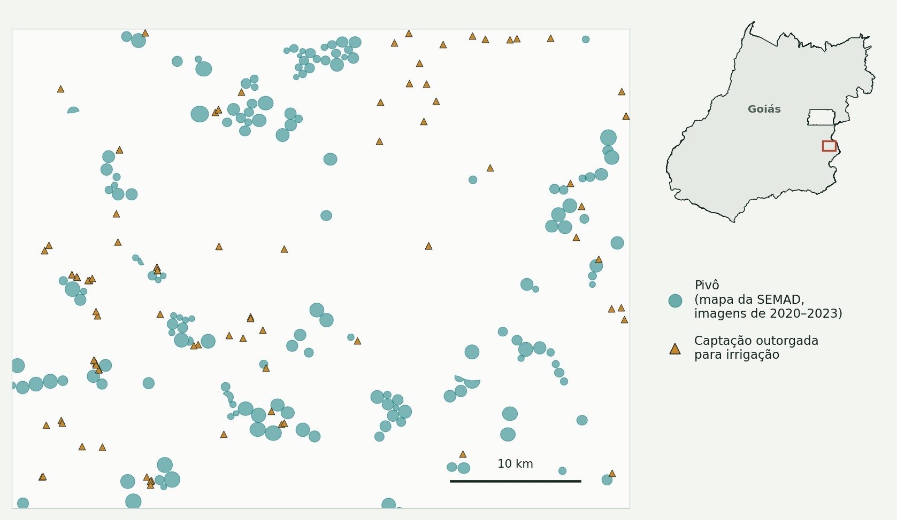
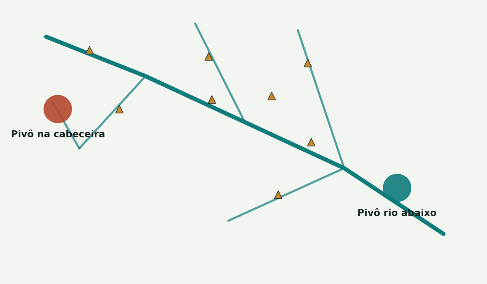

# 3. Cruzar pivôs e outorgas

## O problema de fundo: as duas bases não conversam

- O **pivô** é uma **área** (um polígono no mapa).
- A **outorga** é um **ponto**: onde a água é captada.
- **Nenhum código liga um ao outro** nos dados públicos. A captação pode ficar longe do pivô, ser um poço, ou ser um barramento que atende vários pivôs.

Por isso, qualquer cruzamento automático com os dados públicos é uma **aproximação**. O vínculo confiável provavelmente depende de um dado interno da SEMAD, como o polígono da área irrigada no processo de outorga ou o número do CAR.

## Três versões da regra, e o que cada uma ensinou

### Versão 1: distância simples

"Algum ponto de outorga de irrigação a até 2 km do pivô?"

- Resultado: cerca de **2.550 pivôs e 139 mil ha** em Goiás sem nenhuma outorga a até 2 km.
- É um bom ponto de partida, mas mistura vários casos que não são falta de outorga: captação distante, barramento compartilhado, poço, rio federal.

### Versão 2: "qualquer outorga rio acima"

A ideia: o pivô estaria coberto se houvesse alguma outorga a montante na rede de rios.

- **Não funcionou.** Pivô na cabeceira nunca tem nada rio acima; pivô rio abaixo quase sempre tem. A regra media a **posição do pivô no rio**, não a documentação. A correlação da cobertura com a posição na rede de drenagem foi de +0,84.

### Versão 3 (atual): mesma sub-bacia e distância

Implementada em `codigo/demo_reconciliacao.py`:

1. Para cada pivô, acha o trecho de rio da BHO mais próximo e a sua sub-bacia (`cobacia`).
2. Procura outorgas de irrigação de **domínio estadual** na **mesma sub-bacia**.
3. Classifica pela outorga mais próxima:

| Nível | Critério | Leitura |
|---|---|---|
| **A** | até 5 km, e área declarada compatível (ou não declarada) | outorga compatível por perto |
| **B** | de 5 a 15 km | outorga possível |
| **C** | nenhuma na sub-bacia até 15 km, ou área declarada menor que metade da área do pivô | **nenhuma outorga localizada pela regra**. Não quer dizer "sem outorga" |

Resultado (5.817 áreas únicas em Goiás): **A = 1.571, B = 3, C = 4.243 (73%)**.

**Esta versão ficou rígida demais.** As sub-bacias da BHO no nível usado são pequenas, e a captação muitas vezes fica num afluente vizinho. Conferindo uma amostra de 2.373 áreas do nível C, **41% tinham uma outorga de irrigação a até 2 km**, só que em outra sub-bacia. Por isso a página de triagem mostra também as outorgas a até 5 km em qualquer sub-bacia (`codigo/aux_outorgas_proximas.py`).

## Correções feitas no caminho

| O que aconteceu | Como foi pego | Ajuste |
|---|---|---|
| Pivôs a 22 km da outorga mais próxima ganharam uma explicação técnica plausível | Conferindo a posição contra o limite do IBGE: 812 dos 1.663 pivôs da camada de São Marcos estão em Minas e no DF | Considerar só pivôs em Goiás |
| As quatro camadas de pivôs contavam os mesmos pivôs várias vezes | Comparando a sobreposição real dos polígonos | Juntar por sobreposição (7.340 → 5.817) |
| A regra "rio acima" | Olhando onde ficavam os pivôs "cobertos" | Mesma sub-bacia e distância |
| O campo do número do ato estava com o nome errado no script da fila (`int_num_ato` em vez de `int_nu_ato`) | Revisando a saída | Corrigido |

## Como melhorar

- **O ideal é um código de ligação.** Se o sistema interno de outorga tiver o polígono da área irrigada, o número do CAR ou o número do processo ligado ao pivô, o cruzamento deixa de ser aproximado.
- Sem isso, um meio-termo é usar uma regra por distância **e** sub-bacia vizinha, calibrada com os casos que o analista conferir na triagem.
- Incluir as **outorgas federais da ANA** (não estão no SIGA) e as captações subterrâneas, que têm regras próprias.
