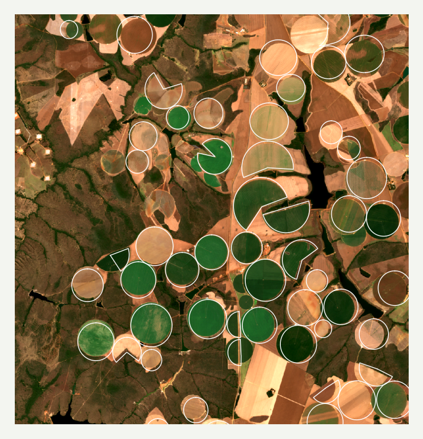

# 4. Detectar irrigação nas imagens

A detecção é a parte que o pedido descreve como gargalo: hoje ela é feita à mão, olhando imagens, e só quando surge uma demanda. Este teste **não** construiu um detector. Ele fez algumas medições para entender o que funcionaria.

## Uma data da seca não basta

O primeiro impulso é olhar uma imagem de agosto e marcar o que está verde. Na prática:

Num recorte de cerca de 13 km em Cristalina (1º/8/2025), dos **54 pivôs** do mapa da SEMAD, **21** estavam verdes (NDVI acima de 0,6) e **23** secos (abaixo de 0,35). Um pivô seco em agosto pode ter sido colhido, estar em descanso ou parado. E uma lavoura de safrinha pode estar verde sem irrigação.

## A série ao longo da seca separa bem melhor

Teste do script `codigo/aux_deteccao_temporal.py`: 20 pivôs conhecidos e 150 áreas de referência fora de pivôs, num recorte de 31 × 20 km entre Campo Alegre de Goiás e Catalão, com imagens de maio a outubro de 2025.

| O que foi medido | AUC |
|---|---|
| NDVI de uma data de agosto | **0,44** (não separa) |
| Desvio-padrão do NDVI ao longo da série | **0,84** |
| Amplitude do NDVI na série | 0,83 |
| Máximo do NDVI na série | 0,81 |

**Leitura:** o pivô fica verde em parte da seca, enquanto a vegetação ao redor seca. A estação seca é a **janela para coletar imagens**; o critério é o **comportamento ao longo dela**. É também o caminho da literatura: métricas da série temporal e um classificador treinado com exemplos conferidos (a IA citou Bendini et al., 2019, sobre métricas fenológicas no Cerrado; o artigo não foi conferido).

**Ressalvas deste teste** (vale refazer antes de usar o número):

- a conta foi feita por pixel, não por pivô, o que faz o resultado parecer mais firme do que é;
- não descontou o acréscimo de 1000 das imagens Sentinel-2 recentes (ver [dados](02-dados-publicos.md#imagens-sentinel-2));
- é um recorte só, com 20 pivôs.

## Exemplo real: a série na página de triagem

O script `codigo/aux_imagens_fila.py` calcula, para cada área da fila de triagem, o NDVI médio dentro do pivô e num anel de 200 a 800 m em volta (sem os outros pivôs mapeados), em cada data sem nuvem de abril a outubro de 2025 (já com o desconto do Sentinel-2 e com nuvem e sombra removidas pela banda SCL). Dois casos ilustram o que a série mostra:

- **C-01 (Cristalina):** o pivô sai de 0,82 em maio e cai até ~0,22 em outubro, acompanhando o entorno. Parece colhido em julho e parado depois.
- **C-02 (Jussara):** o pivô cai para ~0,20 em junho e julho (colheita), sobe de novo a partir de meados de agosto e chega a 0,76 em setembro, enquanto o entorno fica perto de 0,45. Sinal típico de novo plantio irrigado em plena seca.

## Detectar pivô novo

Comparando o mapa de 2016 com o de 2023, surgiram cerca de **2.400 pivôs em sete anos** (~20 mil ha por ano). Então é provável que existam muitos pivôs abertos depois de 2023 que ainda não estão no mapa público. A SEMAD já vem atualizando o mapa à mão, por bacia (Araguaia 2025, Alto São Marcos 2026).

Um teste simples de mudança (`codigo/aux_teste_mudanca.py`: comparar o NDVI de uma data da seca de 2022 com uma de 2025 e procurar manchas circulares que ficaram mais verdes) **não achou candidatos** e não separou pivôs conhecidos de áreas de referência (AUC 0,46). Isso diz mais sobre o método (uma data de cada ano) do que sobre a quantidade de pivôs novos.

Caminhos mais promissores:

- usar a **série** de cada ano, e não uma data;
- usar a **forma**: pivô é um círculo, e detectores de forma (ou redes treinadas para isso) funcionam bem;
- usar o **MapBiomas Irrigação** como triagem: o pivô que aparece lá e não está no mapa da SEMAD é um candidato a pivô novo. Limites: imagens de 30 m, mapa anual e publicado com atraso.

## Por que a triagem vem antes do detector

Um classificador precisa de exemplos conferidos para aprender e para medir o erro, e hoje eles quase não existem. A [página de triagem](05-prototipo-de-triagem.md) produz exatamente isso: cada caso marcado por uma pessoa vira um exemplo. Os mapas feitos à mão pela SEMAD (2016, 2023, 2025, 2026) são outra fonte valiosa de exemplos.
