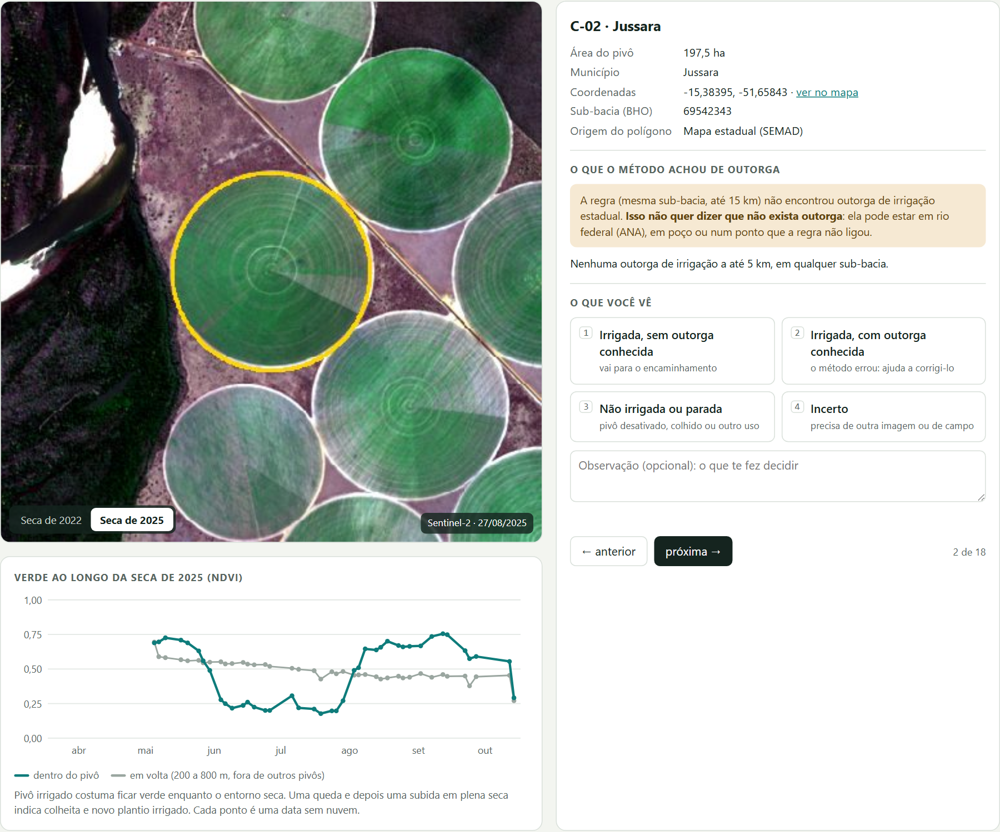

# 5. O protótipo de triagem

**Para abrir:** [página publicada](https://victorgit10.github.io/irrigacao-outorga-ia/triagem/) ou o arquivo `codigo/saida/revisao_pivos.html` (abre com dois cliques, sem internet).

## Para que foi pensado

Depois do primeiro encontro, a conversa chegou a um desenho para o problema todo:

1. **detectar** os pivôs nas imagens de satélite, de tempos em tempos (por exemplo, a cada estação seca);
2. **cruzar** os pivôs encontrados com as outorgas;
3. montar uma **fila** com os casos sem outorga por perto, com as imagens de cada um;
4. uma pessoa faz a **inspeção visual** de cada caso e marca o que vê;
5. as marcações viram um **relatório estruturado**, pronto para os encaminhamentos seguintes.

A ideia é dividir o trabalho: o computador faz a parte repetitiva (achar candidatos, juntar imagens e outorgas) e a pessoa faz só a parte que exige julgamento. É o mesmo princípio do DETER, do INPE: alerta automático, verificação humana e só então o laudo.

Esse desenho foi proposto pelo Victor depois do encontro. Uma IA (DeepSeek) montou a primeira versão da página a partir dele; depois ela foi conferida e ajustada (ver abaixo).

## Por que começar pela triagem, e não pelo detector

- **Falta de exemplos.** Para treinar e medir um detector, é preciso de casos conferidos ("isto é pivô irrigado", "isto não é"). Eles quase não existem. Cada marcação na triagem é um desses exemplos.
- **A triagem tolera erro.** Um detector que decide sozinho precisa acertar quase sempre. Um detector que só monta uma fila para alguém olhar pode errar bastante, desde que a fila tenha um tamanho que dê para revisar.
- **O relatório já serve.** Mesmo sem detector, a fila feita a partir do mapa existente já produz um resultado útil para o trabalho.

## O que a página faz



Para cada área da fila, mostra:

- **imagem em cor natural** da seca de 2022 e da de 2025, com o contorno do pivô em amarelo (a melhor imagem sem nuvem sobre o pivô em cada período);
- **gráfico do NDVI** de abril a outubro de 2025, dentro do pivô e em volta dele (ver [detecção](04-deteccao-por-satelite.md#exemplo-real-a-série-na-página-de-triagem));
- área, município, coordenadas (com link para o mapa) e sub-bacia;
- **o que o cruzamento achou de outorga**: o resultado da regra e as outorgas de irrigação a até 5 km, em qualquer sub-bacia, com número do ato, distância, tipo de captação e situação. Nunca mostra nome ou CPF/CNPJ.

A pessoa marca uma de quatro respostas:

| Resposta | Para que serve |
|---|---|
| Irrigada, sem outorga conhecida | vai para a lista de encaminhamento |
| Irrigada, com outorga conhecida | mostra onde o cruzamento erra; pede o número do ato, se a pessoa souber |
| Não irrigada ou parada | pivô desativado, colhido, ou outro uso |
| Incerto | precisa de outra imagem ou de vistoria |

Também guarda uma observação livre, o nome de quem revisou e a hora. Na aba **Relatório**, monta na hora uma tabela e um texto em Markdown, separados por resposta, que podem ser baixados (`.md` e `.csv`).

**O relatório nunca conclui irregularidade.** Ele registra o que foi visto na imagem e o que o cruzamento automático encontrou. A verificação e a decisão são do setor competente, no processo, com contraditório.

## O que mudou da primeira versão

A primeira versão (feita pelo DeepSeek) já tinha o ciclo completo. Testando, foram feitos estes ajustes:

| Primeira versão | Agora | Por quê |
|---|---|---|
| Ao marcar, pulava para o caso seguinte | Fica no caso; avança com "próxima" | A observação digitada depois de marcar ia parar no caso seguinte |
| Três botões: confirmado, rejeitar, incerto | Quatro respostas com o que cada uma significa | "Confirmado" era ambíguo, e faltava "tem outorga que eu conheço", a resposta que mais ajuda a corrigir o cruzamento |
| Imagem com menos nuvem na cena inteira | Imagem sem nuvem sobre o pivô e com o recorte inteiro coberto | Alguns recortes saíam com faixa preta na borda |
| Só as duas imagens | Mais o gráfico do NDVI ao longo da seca | Uma data só separa mal pivô irrigado de lavoura colhida |
| Só o resultado da regra da sub-bacia | Mais as outorgas a até 5 km em qualquer sub-bacia | Em 5 dos 18 casos havia outorga a menos de 2 km, fora da sub-bacia |
| CSV com vírgula e ponto decimal | CSV com ponto e vírgula e vírgula decimal | Abre direto no Excel em português |

## Os 18 casos de exemplo

A fila tem 18 pivôs reais do mapa público, um por município, escolhidos entre os maiores (a partir de 60 ha) de nível C e em rio estadual (`codigo/aux_gerar_fila.py`). Não é uma amostra do estado: serve para demonstrar o ciclo.

Em dois casos o polígono do mapa é só o contorno do pivô ou um pedaço dele. No C-16, o script achou o círculo inteiro numa camada vizinha; no C-11, não, e a página avisa que o contorno e o gráfico usam só a parte mapeada.

Conferindo a fila: em 13 dos 18 casos não há nenhuma outorga de irrigação a até 2 km, em qualquer sub-bacia; nos outros 5, há uma entre 0,9 e 1,8 km. Esses 5 são bons para testar a pergunta "você conhece a outorga deste?".

## Como funciona por dentro

```
camadas da SEMAD ──► aux_gerar_fila.py ──► saida/fila_revisao.json
                                              │
Sentinel-2 ────────► aux_imagens_fila.py ─────┤  (recortes 2022/2025 e série de NDVI)
outorgas ──────────► aux_outorgas_proximas.py ┤  (outorgas a até 5 km)
                                              ▼
                     aux_gerar_interface.py ──► docs/triagem/index.html
                                                codigo/saida/revisao_pivos.html
```

- A página é **um arquivo HTML só**, com as imagens embutidas (~2 MB). Não usa servidor, login nem bibliotecas externas.
- As marcações ficam no navegador de quem usa (`localStorage`). **Não são enviadas a lugar nenhum.** Para guardar, é preciso baixar o CSV ou o relatório. Se abrir em outro computador ou limpar os dados do navegador, as marcações não aparecem.
- Atalhos: teclas 1 a 4 marcam; setas navegam.

## Para usar com outra bacia ou outros casos

1. Ajustar a seleção em `aux_gerar_fila.py` (por exemplo, filtrar por uma bacia crítica, ou trocar a fonte dos candidatos por um detector).
2. Rodar, em ordem: `aux_gerar_fila.py`, `aux_imagens_fila.py`, `aux_outorgas_proximas.py`, `aux_gerar_interface.py`.

## O que falta para virar ferramenta de trabalho

| Hoje (protótipo) | Para uso real |
|---|---|
| Marcações no navegador | Banco de dados num servidor da SEMAD, com login e histórico de quem marcou o quê |
| Fila fixa de 18 casos | Fila gerada a cada período, a partir de um detector |
| Duas imagens e uma série | Escolher as datas pela estação de cada ano; talvez imagens de maior resolução (Planet) para os casos duvidosos |
| Relatório em Markdown | No formato do documento que a SEMAD já usa nos encaminhamentos |
| Cruzamento aproximado | Vínculo pelo código interno (polígono da área irrigada, CAR ou processo) |
